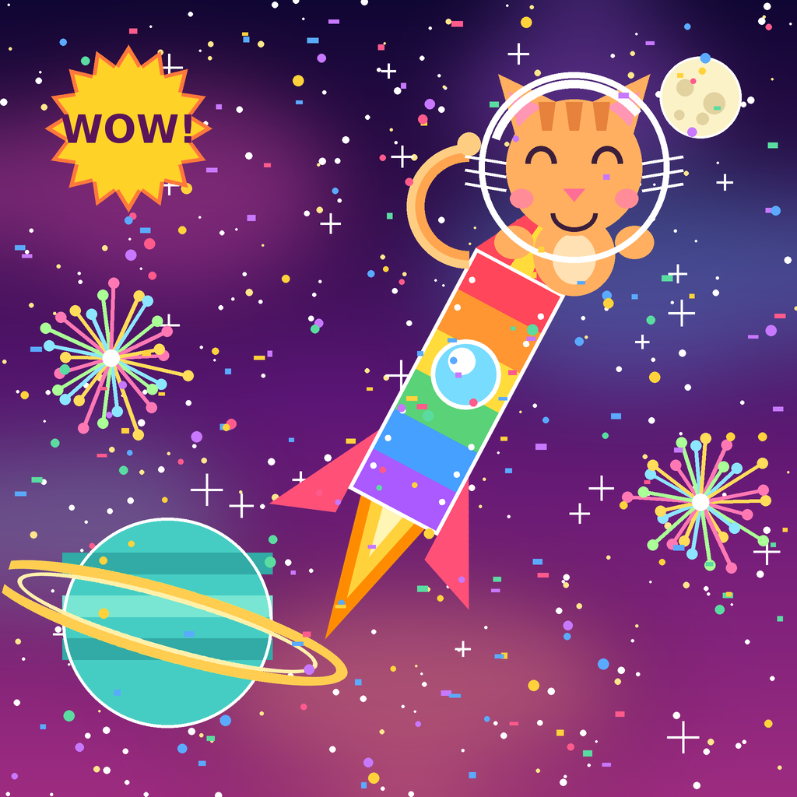

# Cosmic Kitten 🚀🐱

[](https://make.fun/bounty/ai-excited-01?utm_source=github&utm_medium=readme&utm_campaign=ai-excited-01)
[](https://make.fun/bounty/ai-excited-01/leaderboard?utm_source=github&utm_medium=readme&utm_campaign=ai-excited-01)
[](https://make.fun/bounty/ai-excited-01?utm_source=github&utm_medium=readme&utm_campaign=ai-excited-01)

A joyful kitten astronaut riding a rainbow rocket through a candy nebula — with a ringed planet, the moon, fireworks, confetti, and a big **WOW!** badge. Made to make the AI judge excited.



## How it works

`generate_image.py` draws the whole scene from scratch with PIL + numpy (rendered at 2048×2048, downscaled to 1024×1024). It is fully offline and deterministic — same seed, same pixels, every run.

`main.py` (stdlib only) copies `asset.png` to `$MAKEFUN_OUTPUT_DIR/entry.png`, validating the PNG header and the 1 MiB size limit first.

## Run it

```bash
python3 generate_image.py
MAKEFUN_OUTPUT_DIR=./out python3 main.py
```

## Bounty

Built for [make.fun — ai-excited-01](https://make.fun/bounty/ai-excited-01).

## License

MIT — see [LICENSE](LICENSE).
